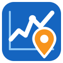
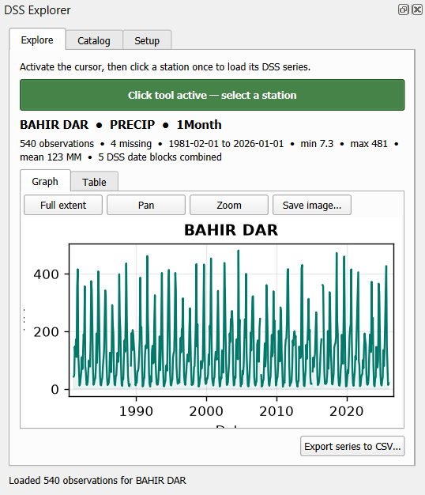

<p align="center">
  
</p>

<h1 align="center">DSS Link for QGIS</h1>

<p align="center">
  Link HEC-DSS time series to map stations — explore, chart and export them inside QGIS.
</p>

<p align="center">
  <a href="https://github.com/HundesaSiraj/dss-link-qgis/actions/workflows/tests.yml"></a>
  <a href="https://github.com/HundesaSiraj/dss-link-qgis/releases"></a>
  
  <a href="https://plugins.qgis.org/plugins/dss_link/"></a>
  <a href="LICENSE"></a>
</p>

> [!TIP]
> **Install directly in QGIS:** *Plugins › Manage and Install Plugins*, search
> for **DSS Link** and click **Install**. DSS Link is published in the
> [official QGIS plugin repository](https://plugins.qgis.org/plugins/dss_link/).
>
> Offline? Download **`dss_link-<version>.zip`** from the
> [latest release](https://github.com/HundesaSiraj/dss-link-qgis/releases/latest)
> and use *Install from ZIP*. Do **not** use the green **Code › Download ZIP**
> button — that is the source repository, not an installable plugin.

---

**DSS Link** connects [HEC-DSS](https://www.hec.usace.army.mil/software/hec-dss/)
files — the time-series store used by HEC-HMS, HEC-RAS, HEC-DSSVue and other
HEC tools — to a point station layer in QGIS. Click a station on the map to see
its record as an interactive graph and table, browse the DSS catalog, export a
series to CSV, or write everything to a temporal GeoPackage for the QGIS
Temporal Controller.

<p align="center"></p>

## Features

| | |
|---|---|
| **DSS Explorer** | Dock panel with a one-click station tool. Interactive graph (hover for date and value, pan, zoom, save image), sortable table, summary statistics (count, missing, min, max, mean) and **CSV export**. |
| **Catalog browser** | Filter by C (parameter), E (interval) and F (version). D-part date blocks — e.g. one block per decade — are merged into **one logical series** automatically. |
| **GeoPackage export** | `stations` and temporal `dss_observations` layers with native datetime, value, units and full pathname traceability. Progress bar with Cancel. |
| **Robust matching** | Station IDs match regardless of case, spaces, underscores or hyphens, in any script. Duplicate IDs are reported. |
| **Easy setup** | One-click installer for the `pydsstools` dependency — no OSGeo4W Shell needed. Settings are remembered between sessions. |
| **Safe** | DSS files are opened read-only; the output never overwrites an existing file. |
| **Compatible** | QGIS 3.28 and newer, including QGIS 4 (Qt6). |

## Installation

1. In QGIS open **Plugins › Manage and Install Plugins › All**.
2. Search for **DSS Link** and click **Install Plugin**.
3. Open **Plugins › DSS Link › Open interactive DSS Explorer**.
4. If the **Setup** tab shows *pydsstools is not installed*, click
   **Install pydsstools** and wait about a minute (internet required).

Without internet access in QGIS, download `dss_link-<version>.zip` from the
[latest release](https://github.com/HundesaSiraj/dss-link-qgis/releases/latest)
and use **Install from ZIP** instead (not the *Code › Download ZIP* archive).

> **Platform support.** pydsstools provides ready-made packages for **Windows**
> and **Linux** (64-bit, Python 3.9–3.13), which covers current QGIS releases.
> On macOS it must be built from source.

## Quick start

1. Load your station point layer in QGIS.
2. In **DSS Explorer › Setup** choose the DSS file, the station layer, the
   station ID field and the DSS pathname part that holds the station ID
   (usually **B**), then click **Connect and scan catalog**.
3. In **Explore**, click **Activate station click tool** and click a station.
4. Use **Catalog** to filter by parameter, interval or version and pick another series.
5. For a reusable GIS layer use **Plugins › DSS Link › Export DSS to linked GeoPackage**.

Full documentation: [dss_link/README.md](dss_link/README.md) ·
Version history: [CHANGELOG](dss_link/CHANGELOG.md)

## Try it with the sample data

[`sample_data/`](sample_data) contains a **synthetic** DSS file and a station
GeoPackage for six Ethiopian towns. The values are random but reproducible —
they are **not observations**. Load `sample_stations.gpkg`, then in Setup choose
`sample_stations.dss`, field `Name`, part `B`.

The dataset deliberately includes multi-block monthly and daily series, a DSS
station without a map point (GAMBELA) and a map point without DSS data (Jimma),
so every message of the plugin can be seen. Rebuild it with
[`scripts/make_sample_data.py`](scripts/make_sample_data.py) from the QGIS
Python console.

## Development

```text
dss_link/         the QGIS plugin — this folder is what goes into the zip
tests/            unit tests for the QGIS-independent code
scripts/          build_zip.py, make_sample_data.py
sample_data/      synthetic demonstration data
docs/             screenshots
```

```bash
python -m unittest discover -s tests -v    # run the tests
python scripts/build_zip.py                # build dist/dss_link-<version>.zip
```

Pushing a tag such as `v1.0.0` builds the plugin zip and publishes a GitHub
release automatically. See [CONTRIBUTING.md](CONTRIBUTING.md).

## Authors

**Hundesa Siraj Mohammed** — concept originator and lead developer.
Remote Sensing Specialist, Climate Data Analyst, Hydrogeologist and WebGIS Expert.

**Marta Fikadu Shikur** — contributor.
Remote Sensing Specialist and Extreme Event Modeller, experienced with SMEV,
GEV and related extreme-value methods.

## Citation

If DSS Link supports your research or reports, please cite it — GitHub's
**Cite this repository** button uses [`CITATION.cff`](CITATION.cff):

> Mohammed, H. S., & Shikur, M. F. (2026). *DSS Link: a QGIS plugin linking
> HEC-DSS time series to map stations* (Version 1.0.0) [Computer software].
> https://github.com/HundesaSiraj/dss-link-qgis

## Acknowledgements and licence

DSS Link reads DSS files through [pydsstools](https://github.com/gyanz/pydsstools)
(MIT, Gyan Basyal). HEC-DSS is developed by the US Army Corps of Engineers
Hydrologic Engineering Center; DSS Link is an independent project and is not
affiliated with or endorsed by USACE.

Released under the [MIT licence](LICENSE).
